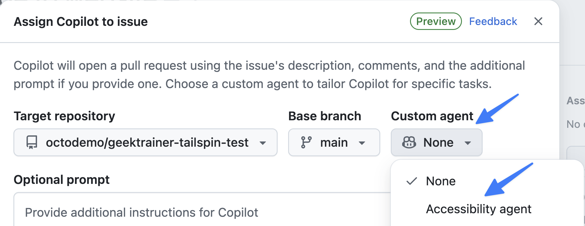

## 什么是自定义智能体？

GitHub Copilot 中的[自定义智能体][custom-agents-concept]是针对开发工作流中特定任务或领域定制的专用人工智能（AI）助手。通过在仓库的 `.github/agents` 文件夹中使用 Markdown 文件定义智能体，你可以为 Copilot 提供有针对性的指令、最佳实践、编码模式和领域知识，帮助它更有效地完成特定类型的工作。团队可以将专业知识编码为可复用的智能体，例如执行 [Web 内容无障碍指南（WCAG）][wcag] 合规要求的无障碍智能体、遵循安全编码实践的安全智能体，或维护一致测试模式的测试智能体。

自定义智能体通过项目 `.github/agents` 文件夹中的 Markdown 文件定义，也可以全局存放在 `~/.copilot/agents`。每个文件都包含 YAML（YAML Ain't Markup Language）frontmatter，至少包含 `name` 和 `description`，后面是用于定义智能体行为、专业知识和指令的 Markdown 提示。

### 自定义智能体与智能体技能的比较

自定义智能体和[智能体技能][agent-skills-concept]有些相似。两者主要通过 Markdown 文件定义，并指导 AI 如何执行操作。最简单的区分方式是：**自定义智能体**是执行者，**技能**是工具。

自定义智能体有独立的上下文窗口，并用于协调技能（甚至其他智能体）完成工作。在本实验中，无障碍自定义智能体会根据无障碍指南审查和更新网站；在此过程中，它可以调用拉取请求工作流技能或运行和管理测试的技能。

> [!NOTE]
> 编写自定义智能体没有唯一的“正确”方式。与 AI 的其他用法一样，需要通过测试和迭代，找到最适合自身工作环境和场景的方式。

[custom-agents-concept]: https://docs.github.com/copilot/concepts/agents/cloud-agent/about-custom-agents
[agent-skills-concept]: https://docs.github.com/copilot/concepts/agents/about-agent-skills
[wcag]: https://www.w3.org/WAI/standards-guidelines/wcag/

使用自定义智能体时，你将探索：

- 如何定义自定义智能体。
- 如何将任务分配给自定义智能体。

## 场景

Tailspin Toys 致力于确保所有用户都能使用其众筹平台，无论用户的视觉能力或偏好如何。近期用户反馈指出，当前深色主题的文字与背景颜色对比度不足，导致部分用户难以阅读。为解决这一无障碍问题，设计团队要求实现一种可由用户开关的高对比度模式。

无障碍功能至关重要，因此需要尽快实现。你将使用自定义智能体生成此功能。

## 查看无障碍自定义智能体

我们已为你创建了无障碍自定义智能体。查看 `.github/agents/accessibility.md` 中的配置，了解它如何引导 Copilot。

1. 返回 codespace 并打开 `.github/agents/accessibility.md`。
2. 查看包含 `name` 和 `description` 字段的 YAML frontmatter。

> [!CAUTION]
> `name` 和 `description` frontmatter 是自定义智能体的必需项。

3. 接着浏览并审查后续部分，了解其中介绍的内容：
   - 为无障碍网站生成代码时的核心职责。
   - 无障碍最佳实践。
   - 超文本标记语言（HTML）、层叠样式表（CSS）和 JavaScript 代码示例。
   - 常见问题和错误列表。

## 创建并分配议题

智能体控制中心是管理工作环境中所有智能体的中心位置。你可以向 Copilot 云智能体分配任务、监控任务，甚至重定向会话并提供更多指导。现在先将实现高对比度模式的任务分配给 Copilot。

1. 打开仓库。
2. 选择 **Issues** 选项卡。
3. 选择 **New issue** 打开新建议题对话框。
4. 选择 **Blank issue** 创建空白议题。
5. 将 **Title** 设置为 `Add high contrast mode to website`。
6. 将 **Description** 设置为：

    ```plaintext
    We need a high contrast mode for the site. There should be a toggle for high contrast which the user can set. It should store the setting in local storage on the browser.
    ```

7. 选择 **Create** 创建议题。
8. 在右侧选择 **Assign to Copilot**，打开分配对话框。
9. 从自定义智能体列表中选择 **Accessibility agent**。

    

10. 选择 **Assign**。
11. Copilot 会在后台开始处理任务。

## 总结和后续步骤

本课介绍了 GitHub Copilot 中的[自定义智能体][custom-agents]，即针对特定任务和领域定制的专用 AI 助手。使用自定义智能体可以将团队专业知识和标准整理成可复用的智能体，帮助 Copilot 更有效地完成特定类型的工作。

你探索了以下内容：

- 如何定义自定义智能体。
- 如何将任务分配给自定义智能体。

Copilot 正在实现高对比度模式，接下来可在智能体控制中心[监控并引导智能体会话][next-lesson]。

## 资源

- [关于自定义智能体][custom-agents]
- [为组织使用自定义智能体做准备][org-custom-agents]
- [为企业使用自定义智能体做准备][enterprise-custom-agents]

---

| [← 上一课：GitHub Copilot 云智能体][previous-lesson] | [下一课：监控和管理智能体 →][next-lesson] |
|:--|--:|

[previous-lesson]: ../2-cloud-agent/
[next-lesson]: ../4-managing-agents/
[custom-agents]: https://docs.github.com/copilot/concepts/agents/cloud-agent/about-custom-agents
[org-custom-agents]: https://docs.github.com/copilot/how-tos/administer-copilot/manage-for-organization/prepare-for-custom-agents
[enterprise-custom-agents]: https://docs.github.com/copilot/how-tos/administer-copilot/manage-for-enterprise/manage-agents/prepare-for-custom-agents
